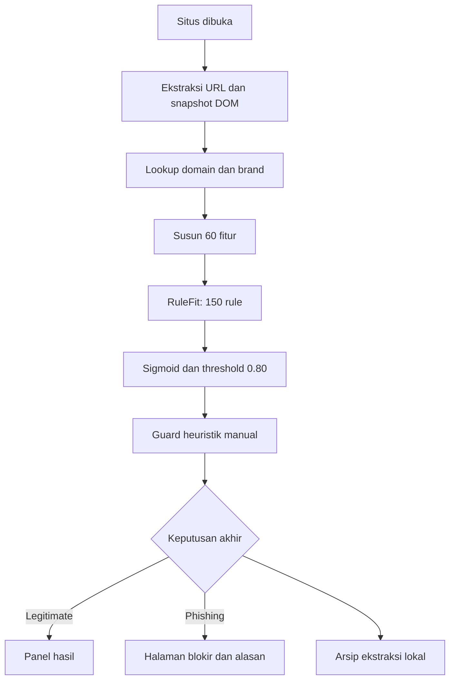
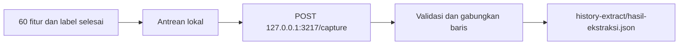

# HeuriShieldV3

Extension pendeteksi indikasi phishing melalui **URL, DOM, domain dan brand**. Engine lokal: **RuleFit 60 fitur, 150 rule, threshold 0,80**, dilengkapi guard heuristik manual. Nama repository V3 berbeda dari versi manifest.

## Instalasi

```sh
git clone https://github.com/UmarFaruqManek/HeuriShieldV3.git
```

1. Buka `chrome://extensions`, aktifkan **Developer mode** dan **Load unpacked**.
2. Pilih folder hasil clone yang berisi `manifest.json`, lalu buka situs HTTP/HTTPS.
3. Pembaruan: `git pull`, kemudian **Reload** extension.

Deteksi tidak perlu build, npm install, Python, atau server lokal. ZIP GitHub juga bisa dipakai setelah diekstrak. Chrome/Chromium desktop adalah target pengujian utama. Edge/browser Chromium lain perlu verifikasi; Firefox/Safari perlu porting; mobile belum didukung paket ini.

## Alur Keputusan



| Analyzer | Yang dibaca |
|---|---|
| URL | Panjang alamat/path, karakter, token, subdomain, alamat awal/akhir dan konteks redirect. |
| DOM | Tautan, script, aset, teks, form kredensial dan tujuan pengirimannya. |
| Domain | Umur pendaftaran, ketersediaan metadata dan nameserver. |
| Brand | Kandidat dari judul/alamat; kemiripan dan kecocokan domain. |

**Heuristik** mendasari indikator dan aturan praktis. **RuleFit** mempelajari kondisi/bobot dari data; extension hanya menjalankan model terlatih. Fitur kosong memakai median engine saat evaluasi, bukan dianggap hasil pengamatan.

```text
rule_aktif = 1 jika seluruh kondisi terpenuhi (AND), selain itu 0
z = intercept + sum(koefisien_rule * rule_aktif)
p_model = 1 / (1 + exp(-z))
p_model >= 0,80 -> phishing; selain itu -> legitimate
```

Guard kecocokan brand, redirect dan impersonasi dapat mengubah keputusan. Guard adalah aturan manual di luar 150 rule pelatihan; skor setelah guard bukan probabilitas murni RuleFit. Detail alasan merangkum maksimal tiga temuan, bukan mengklasifikasi ulang.

## API dan Urutannya

| Kelompok | Endpoint |
|---|---|
| Brand 1 | `https://autocomplete.clearbit.com/v1/companies/suggest?query={token}` |
| Brand 2 | `https://api.brandfetch.io/v2/search/{query}` |
| Domain 1 | `https://api-check-beryl-beta.vercel.app/api/whois?domain={domain}` |
| Domain 2, opsional | `http://localhost:3000/api/whois?domain={domain}` |
| Domain 3 | `https://whois-api-dun.vercel.app/api/whois?domain={domain}` |
| Domain 4 | `https://who-dat.as93.net/{domain}` |

Clearbit menyediakan kandidat utama. Brandfetch melengkapi skor hanya untuk domain kandidat yang sama atau menjadi fallback. Lookup domain beralih berurutan saat sumber gagal/tidak memadai. API membutuhkan internet dan dapat terkena timeout/rate limit. RuleFit tidak memakai API klasifikasi eksternal. Localhost:3000 di atas berbeda dari server pencatatan berikut.

## History Extract: Pola V4

Untuk mencatat langsung ke folder extension, jalankan **Node.js 18+**, tanpa npm install:

```powershell
# Dari folder extension; biarkan terminal berjalan selama pencatatan.
.\Jalankan_Pencatatan.ps1
# Alternatif lintas platform:
node tools/extension-capture-server.mjs
```



- **Server harus berjalan**, tetapi tab pengaturan boleh ditutup. Tidak memakai Downloads, pemilih file, Native Messaging atau registrasi Windows. `Ctrl+C` menghentikan server.
- File adalah **array JSON: URL + 60 fitur + label prediksi**. Missing tetap `null`; label bukan ground truth. Data lama digabungkan dan baris identik tidak ditambahkan ulang, termasuk setelah restart server.
- Query/fragment/userinfo disamarkan; path masih dapat memuat informasi pribadi. Isi form, password/OTP dan HTML lengkap tidak dicatat dalam dataset ini.
- Pencatatan aktif secara default pada instalasi baru; toggle di **Pengaturan -> Pencatatan dataset JSON**. Jika server mati, data menunggu lokal. Setelah server hidup klik **Simpan ulang** atau buka situs berikutnya. Penampungan lokal maksimal 2.000 catatan; saat penuh pengumpulan dihentikan tanpa menghapus data.
- Jangan edit file saat server berjalan. Salin file JSON untuk dibagikan; masing-masing teman menjalankan server dari salinan extension sendiri. Hanya satu server pada port 3217. Status: `http://127.0.0.1:3217/health`.

## Peta Kode

| Lokasi | Fungsi |
|---|---|
| `src/background/` | Koordinasi analisis, penyimpanan dan proteksi. |
| `src/analyzer/` | Extractor URL/DOM/domain/brand; guard di `runtime-analysis.js`. |
| `src/rule/` | Kontrak 60 fitur, engine 150 rule dan evaluator matematika. |
| `src/shared/analysis-explanation.js` | Penjelasan temuan. |
| `src/content/`, `src/warning/` | Snapshot, panel, halaman blokir dan konteks situs asal. |
| `src/storage/`, `src/dataset/` | Arsip lokal, antrean dan pengaturan pencatatan. |
| `tools/extension-capture-server.mjs` | Server loopback penulis JSON, seperti V4. |

## Batasan

HeuriShield bukan antivirus atau pendeteksi semua malware/ransomware. Legitimate tidak menjamin aman; situs dapat terbuka sebelum analisis selesai. Respons API, konten dinamis dan redirect dapat mengubah hasil. Repository tidak memuat dataset pengguna atau data latih. Baca [PRIVACY.md](PRIVACY.md) sebelum memakai atau membagikan hasil.
