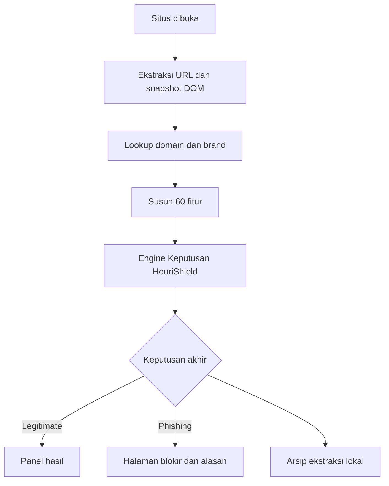
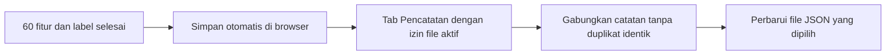

# HeuriShield

Extension pendeteksi indikasi phishing melalui **URL, DOM, domain dan brand**. **Engine Keputusan HeuriShield** menggunakan RuleFit dengan **60 fitur, 150 rule terlatih dan threshold 0,80**, dilengkapi aturan pemeriksaan tambahan dalam satu alur klasifikasi.

## Instalasi

**Ambil paket:** klik **Code -> Download ZIP** di GitHub lalu ekstrak, atau jalankan:

```sh
git clone https://github.com/UmarFaruqManek/HeuriShieldV3.git
```

1. Buka `chrome://extensions`, aktifkan **Developer mode** dan **Load unpacked**.
2. Pilih folder hasil clone/ekstrak yang **langsung berisi `manifest.json`**. Untuk ZIP biasanya bernama `HeuriShieldV3-main`; jangan pilih folder induknya.
3. Selesai. Buka situs HTTP/HTTPS; analisis dan panel hasil berjalan otomatis.

**Tidak perlu build, npm install, Python, server, API key pribadi atau konfigurasi model.** Semua file runtime/model ada di repository. Koneksi internet diperlukan untuk situs dan lookup API. Pencatatan ke file JSON bersifat opsional, bukan syarat deteksi.

Chrome/Chromium desktop adalah target pengujian utama. Edge dapat memakai **Extensions -> Developer mode -> Load unpacked**, tetapi belum diuji selengkap Chrome. Firefox/Safari perlu porting; mobile belum didukung. Pembaruan: `git pull` atau unduh ZIP baru, **Reload** extension, lalu refresh tab situs. Versi paket: **5.0.22**.

## Alur Keputusan



| Analyzer | Yang dibaca |
|---|---|
| URL | Panjang alamat/path, karakter, token, subdomain, alamat awal/akhir dan konteks redirect. |
| DOM | Tautan, script, aset, teks, form kredensial dan tujuan pengirimannya. |
| Domain | Umur pendaftaran, ketersediaan metadata dan nameserver. |
| Brand | Kandidat dari judul/alamat; kemiripan dan kecocokan domain. |

**Heuristik** digunakan untuk membaca indikator situs menjadi fitur. Di dalam engine, RuleFit menjumlahkan bobot rule aktif bersama intercept, mengubah skor dengan sigmoid, lalu membandingkannya dengan threshold. Fitur kosong memakai median engine saat evaluasi.

Nama fitur memakai bahasa Inggris: `source_` untuk URL sumber dan `page_` untuk halaman akhir, misalnya `source_url_length` dan `page_url_length`. Fitur brand disederhanakan menjadi `brand_search_score`, `brand_quality_score`, dan `brand_matches_page`. Penggantian nama tidak mengubah nilai, koefisien, atau keputusan. Dari 60 fitur input, 35 fitur unik muncul dalam kondisi model. [Daftar 60 nama aktif](src/rule/PARAMETER.md) memuat pengelompokan dan padanannya dalam bahasa Indonesia.

Engine juga memeriksa kecocokan brand, indikasi impersonasi dan redirect sebelum menetapkan hasil akhir. Pemeriksaan tambahan ini adalah aturan manual, **bukan bagian dari 150 rule hasil pelatihan**. Semuanya dijelaskan sebagai satu engine keputusan; detail alasan mengutamakan temuan yang dapat dipahami, seperti perbedaan domain brand, redirect, tujuan formulir akun, atau umur domain yang teramati. Hitungan aset dan panjang URL tetap dapat dipakai model, tetapi tidak ditampilkan sebagai alasan tunggal yang menyesatkan.

## API dan Urutannya

| Kelompok | Endpoint |
|---|---|
| Brand 1 | `https://autocomplete.clearbit.com/v1/companies/suggest?query={token}` |
| Brand 2 | `https://api.brandfetch.io/v2/search/{query}` |
| Domain 1 | `https://api-check-beryl-beta.vercel.app/api/whois?domain={domain}` |
| Domain 2, opsional | `http://localhost:3000/api/whois?domain={domain}` |
| Domain 3 | `https://whois-api-dun.vercel.app/api/whois?domain={domain}` |
| Domain 4 | `https://who-dat.as93.net/{domain}` |

Clearbit menyediakan kandidat utama. Brandfetch melengkapi skor hanya untuk domain kandidat yang sama atau menjadi fallback. Lookup domain beralih berurutan saat sumber gagal/tidak memadai. API membutuhkan internet dan dapat terkena timeout/rate limit. RuleFit tidak memakai API klasifikasi eksternal. Localhost:3000 opsional hanya untuk lookup domain, bukan pencatatan.

## History Extract Tanpa Server

Deteksi langsung bekerja tanpa membuka halaman ini. Catatan fitur disimpan lokal di browser. **Opsional:** untuk menyinkronkan ke disk, buka **Pengaturan -> Pencatatan dataset JSON**. Klik **Buat file JSON** untuk membuat `hasil-ekstraksi.json` di lokasi pilihan, atau **Pilih file JSON** untuk menghubungkan file yang sudah ada, lalu izinkan penulisan. **Biarkan tab Pencatatan terbuka** dan gunakan website di tab lain. Tidak perlu server atau unduhan berulang.



- Catatan tetap ada setelah browser ditutup, terpisah dari riwayat kunjungan. Tab ditutup berarti penulisan file berhenti; catatan baru tetap ditampung di browser dan disinkronkan saat tab dibuka lagi dengan izin aktif.
- File adalah **array JSON: URL + 60 fitur + label prediksi**. Missing tetap `null`; label bukan ground truth. Isi lama digabung, bukan dibuang. JSON yang rusak atau berbeda schema ditolak tanpa ditimpa.
- Query/fragment/userinfo disamarkan; path masih dapat memuat informasi pribadi. Isi form, password/OTP dan HTML lengkap tidak dicatat dalam dataset ini.
- Pencatatan aktif secara default pada instalasi baru; toggle di **Pengaturan -> Pencatatan dataset JSON**. Batas 2.000 catatan; saat penuh pengumpulan dihentikan tanpa menghapus data. Batas kuota browser juga berlaku.
- Browser hanya boleh menulis file yang dipilih dan diizinkan pengguna. Handle file diingat di IndexedDB, tetapi browser dapat meminta izin lagi: klik **Izinkan kembali**. Chrome/Edge desktop dengan File System Access diperlukan. Jangan mengedit file yang sama selama sinkronisasi.
- Setiap teman memiliki catatan lokal sendiri dan dapat mengirim satu JSON untuk ditinjau. Jangan menjadikan label prediksi sebagai label pelatihan tanpa verifikasi.

## Peta Kode

| Lokasi | Fungsi |
|---|---|
| `src/background/` | Koordinasi analisis, penyimpanan dan proteksi. |
| `src/analyzer/` | Extractor URL/DOM/domain/brand; guard di `runtime-analysis.js`. |
| `src/rule/` | Kontrak 60 fitur, engine 150 rule dan evaluator matematika. |
| `src/shared/analysis-explanation.js` | Penjelasan temuan. |
| `src/content/`, `src/warning/` | Snapshot, panel, halaman blokir dan konteks situs asal. Snapshot DOM memakai `page-dom-snapshot.bundle.js` yang sudah termasuk dalam paket. |
| `src/storage/`, `src/dataset/` | Arsip lokal, antrean dan pengaturan pencatatan. |

## Batasan

Jika mengubah kode sumber `src/content/page-dom-snapshot.js` atau extractor DOM, jalankan `npm run build:content` sebelum menguji perubahan. Pengguna yang hanya mengunduh atau mengklonakan repository tidak perlu menjalankan perintah ini.

HeuriShield bukan antivirus atau pendeteksi semua malware/ransomware. Legitimate tidak menjamin aman; situs dapat terbuka sebelum analisis selesai. Respons API, konten dinamis dan redirect dapat mengubah hasil. Repository tidak memuat dataset pengguna atau data latih. Baca [PRIVACY.md](PRIVACY.md) sebelum memakai atau membagikan hasil.
